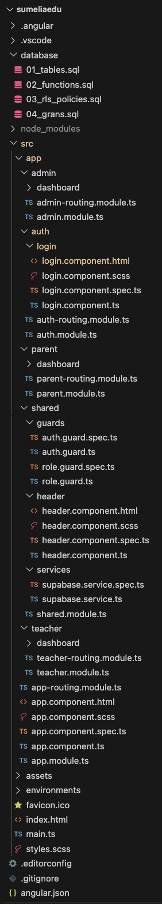

**SumeliaEdu**

La WebApp que comencem a desenvolupar, és una web de gestió educativa,
principalment per a escoles privades locals i/o públiques humils de
Botswana i la regió del SADC. Permet que administradors, professorat i
famílies compartisquen assistència, qualificacions i anuncis en un únic
canal oficial, pensat per a telèfons de gamma mitja i connexions lentes.

**1. Estat del projecte**

Recollim ací la primera fase del desenvolupament que ens ha recomanat el
tutor

-   Estructura inicial del projecte
-   Configuració de Supabase i connexió amb l'aplicació
-   Primera pantalla d'autenticació

Les funcionalitats aplicades són:

-   Inici de sessió amb correu i contrasenya
-   Redirecció automàtica segons els rols establerts (`admin\`,
    `teacher\`, `parent\`).
-   Tancament de sessió.
-   Protecció de rutes amb guards ( sessió activa i rol correcte).
-   Un dashboard mínim per rol, amb una capçalera compartida.
-   Base de dades amb 11 taules, polítiques de seguretat per fila (RLS)
    i permisos per rol de base de dades.

Encara ens falta per implementar -> gestió d'alumnat, assistència,
qualificacions i anuncis. Val a dir que, els dashboards actuals són
minims. Els seu contingut real es construirà a les properes entregues.

**2. Tecnologia i justificació**

-   Frontend. Angular amb NgModules amb la versió 17
-   Components UI. Angular Material amb la versió 17
-   Estils SCSS
-   Backend amb Supabase(PostgreSQL, Auth, RLS) amb la versió
    supabase-js v2
-   Control de versions amb Git

**Per què escollim Angular 17 amb NgModules?** Recorde encara que, a la
matèria Frontend Avançat, a la PAC 5 (Rendiment), escollirem aquesta
versió per separar rutes. Aquesta versió i arquitectura que utilitzarem
m'ha servit d'inspiració. L'arquitectura del nostre projecte té tres
perfils d'usuari ben diferenciats. Cada perfil té el seu propi mòdul(
`AdminModule`, `TeacherModule`, `ParentModule`) que es carreguen
únicament quan l'usuari entra (lazy loading). Això redueix el codi de
descàrrega al navegador, un factor molt interessant amb connexions
lentes.

**Per què Supabase?** El TFM s'orienta al frontend. Desenvolupar un
backend complet portaria molt de temps i, sincerament no tinc els
coneixements suficients. Descobrim i ens documentem amb Supabase qui
ofereix en un sol servei:

-   Una base de dades PostgreSQL.
-   Autenticació amb tokens JWT.
-   Seguretat per fila (RLS) dins la mateixa BBDD.

Aixi, podem aplicar el control d'accés a la base de dades i no només al
codi Angular, que és un punt important en relació amb la seguretat del
projecte.

**3. Com executar el projecte.**

L'aplicació s'obre a `http://localhost:4200` i redirigeix a /auth/login.
`npm start` executa el script `ng serve` que definim a `package.json`,
que utilitza l'Angular CLI 17 instal·lat al projecte.

**La connexió amb Supabase ->** Trobem les credencials a la carpeta
`environments`, així com els diferents scripts a la carpeta `database/`:
`01_tables.sql`, `02_functions.sql`, `03_rls_policies.sql`,
`04_grants.sql`.

Usuaris de prova. Hem seguit la nomenclatura similar a l'escola on
treballava quan estava a Gaborone (Botswana)

-   Administrador : admin@westwood.ac.bw
-   Professor: teacher@westwood.ac.bw
-   Família: parent@westwood.ac.bw

**4. Com comencem a desenvolupar el projecte?**

Comprove primer les eines que ja tinc instal·lades a la màquina:

-   `node --version` -> \# v22.12.0
-   `npm --version` -> \# 11.11.0
-   `git --version` -> \# 2.51.0
-   `ng version` -> \# Angular CLI 21.0.0 (instal·lat globalment)

Per a instal·lar Angular 17, ho faig seguint el següent commant a la
terminal

`npx @angular/cli@17 new sumeliaedu --routing true --style scss --no-standalone`

Amb `npx`, instal·lem Angular 17 de forma temporal. Sols per a aquest
projecte. Amb `--routing true` -\> Generem el sistema de rutes,
necessari per navegar entre el login i els dashboards; amb
`--no-standalone`, generem l'arquitectura tradicional amb NgModules.
Angular CLI inicialitza automàticament el repositori Git i comencem amb
els primers commits.

**Estructural de Mòduls**. Hem creat cinc mòduls amb Angular CLI:

- `ng generate module auth --routing`
- `ng generate module admin --routing`
- `ng generate module teacher --routing`
- `ng generate module parent --routing`
- `ng generate module shared`

Amb`--routing` generem un fitxer `*-routing.module.ts`al costat de cada
mòdul per definir les seues rutes internes. `SharedModule` no en
necessita ja que no té pàgines pròpies: només conté components
reutilitzables.

Mòdul -> Responsabilitat

-   `AuthModule` -\> Login. Accessible sense sessió.
-   `AdminModule` -\> Pantalles de l'administrador.
-   `TeacherModule` -\> Pantalles del professorat.
-   `ParentModule` -\> Pantalles de les famílies.
-   `SharedModule` -\> Serveis, guards i components que usem per tots
    els rols.

**Instal·lació de les dependències**

`ng add @angular/material@17`
`npm install @supabase/supabase-js@2`

**Base de dades.** Val a dir que, abans de configurar la connexió, hem
hagut de crear el projecte a Supabase i el model de dades. Ens referim a aquesta qüestió més avant. L'ordre és important ja que sense taules i usuaris no es pot prova l'autenticació.

**Fitxers d'entorn.**

`ng generate environments`. Amb aquest command creem `environment.ts`
(producció) i `environment.development.ts` (desenvolupament) i afegei una regla `fileReplacements` a `angular.json`. Així, en executar `ng serve`, Angular substitueix automàticament un fitxer per l'altre.
Per això el codi sempre importa `environment.ts`, i Angular tria el
contingut correcte segons l'ordre que s'executa.

**Servei de Supabse.** El creem a
`src/app/shared/services/supabase.service.ts` i centralitza tota la
comunicació amb Supabase. Així, cap component crea la seua pròpia
connexió.

**Dashboards mínims i capçalera**

`ng generate component admin/dashboard`.

`ng generate component teacher/dashboard`

`ng generate component parent/dashboard`+

`ng generate component shared/header`

Com s'observa a la app, de moment les tres pantalles de dashboard són
mínimes. El `HeaderComponent` es crea una sola vegada al `SharedModule`
en lloc de repetir-ho a cada rol. Mostra el nom de l'usuari i el ro,
passat amb `@Input`, i que conté el botó de tancar sessió.

**Scripts SQL al repositori**. L'SQL executat a Supabase el guardem a la
carpeta `database/`, perquè quede versionat amb Git i es puga revisar
pel professor.

**5. Estructura del projecte**

**6. Codi Més Representatiu Explicat**

**SupabaseService.** `src/app/shared/services/supabase.service.ts`

Representa el servei central que gestiona tota la comunicació amb
Supabase. Està creat al mòdul shared perquè els tres rols en faran ús (teacher/parent/admin). Llegim aquest article, junt amb altres pe realitzar el Getting Started amb la BD:
[https://medium.com/@mail_99211/getting-started-with-supabase-a-powerful-backend-as-a-service-alternative-d10bcc616eb3](https://medium.com/@mail_99211/getting-started-with-supabase-a-powerful-backend-as-a-service-alternative-d10bcc616eb3)

`private supabase: SupabaseClient;` -> El client de Supabase -\> Permet interactuar amb la base de dades i altres serveis de Supabase. ÉS la nostra conexió amb la base de dades. "SupabaseClient provides a unified interface for all Supabase operations including database CRUD operations, file storage, and GraphQL queries. It manages HTTP connections, authentication, and request routing automatically." <https://docs.rs/supabase_rs/latest/supabase_rs/struct.SupabaseClient.html>

`signIn(email: string, password: string) {return this.supabase.auth.signInWithPassword({email, password});}`-> Iniciem sessió amb email i password. Valida correu i contrasenya a Supabase Auth. Si són correctes, retorna un token JWT i el navegador el guarda.

`signOut(){return this.supabase.auth.signOut();}` -> Invalida la sessió i esborra el token del navegador.

`getSession() {return this.supabase.auth.getSession();}` -> Retorna la sessió activa, si n'hi ha. És el que consulten els guards.

`async getProfile(userId: string) {return this.supabase.from('profiles').select('*').eq('id', userId).single();}`
-> Llegeix la fila de `profiles` de l'usuari. És on es troba el rol.
Equival a `SELECT * FROM profiles WHERE id = ...`

`get client(): SupabaseClient {return this.supabase; }` -> Exposa el client per fer altres consultes des de futurs serveis

**Guards**

Amb `auth.guard.ts` comprovem que hi haja una sessió activa. Verifica si
l'usuari està loguejat, és a dir, si hi ha una sessió activa. Si no ho
està, el redirigeix al login. Aquest guard s'utilitza per protegir rutes
que només poden ser accedides per usuaris autenticats.

Amb `role.guard.ts` comprovem que el rol de
l'usuari coincideix amb el de la ruta.

-   `CanActivateFn` -\> Tipus d'Angular per a un guard funcional.
-   `inject(SupabaseService)`-\> Obté un servei dins d'una funció, que no té constructor.
-   `roleGuard(requiredRole)` -\> És una funció que retorna un guard. Permet reutilitzar-lo amb rols diferents: `roleGuard('admin')`,`roleGuard('teacher')`.
- `async/await` -\> La consulta a Supabase porta el seu temps. `await` espera la resposta sense bloquejar l'aplicació.

El rol el llegim des de la taula `profiles` i no del token, perquè la taula és la font de veritat i queda protegida per RLS.

**Rutes principals amb lazy loading. **

`src/app/app-routing.module.ts`. Aquest fitxer controla la navegació de
tota l'aplicació.

-   `loadChildren: () => import(...)`-\> Lazy loading. Angular
    descarrega el mòdul només quan algú navega a aquella ruta.
-   `canActivate: [authGuard, roleGuard('admin')]`-\> Doble protecció, executada en ordre: primer sessió, després rol.
-   `path: '**'`-\> Ruta comodí. Captura qualsevol URL desconeguda i
redirigeix al login.

Construïm les rutes en dos trams. `app-routing.module.ts` defineix
`auth`, i `auth-routing.module.ts` defineix `login`. La ruta final és
`/auth/login`. Els mòduls filsl fan us de
`RouterModule.forChild(routes)` i el mòdul arrel usa `forRoot(routes)`.

**Pantalla de login**

-   Lògica amb `login.component.ts` -\> Definim ací el formulari reactiu amb `fb.group`. Tant email com password està definit amb valor inicial i regles; Amb `invalid` + `markAllAstouched()` volem dir que, si el formulari no compleix les regles, no s'envia res i es
mostren els errors als camps; Amb `loading = true`, desactivem el
botó i mostrem l'spinner, per a no premer dues vegades; Amb `signIn`
cridem a Supabase Auth; Un cop estem autenticats, fem us de
`getProfile` per llegir el rol de la taula `profiles`; finalment,
amb `navigate(['/' + profile.role, 'dashboard'])`, redireccionem
automàtica per rol. Cobrim els 3 perfils (`teacher` ens porta a
`teacher/dashboard`) amb una sola línia.
- Vista amb `login.component.html`-\> Tirem ací de Angular Material
per construir la card del login. Fem que siga el més semàtinc i
accessible possible, complint així amb les Pautes d'Accessibilitat
per al Contingut Web (<https://www.w3.org/WAI/standards-guidelines/wcag/es> ) .`LoginComponent` sols fa usa el que AuthModule importa. Per això aquest mòdul importa `ReactiveFormsModule` i els mòduls d'Angular Material que es fan servir a la vista. En cas de faltar-ne cap, la vista dona error.

**`HeaderComponent`** -> el declarem a `SharedModule`. Deixem clar que,un component sols es pot usar dins del mòdul on es declara. Així, els tres mòduls del rol importen `SharedModule` i usen
`<app-header roleLabel = “Admin”>`.
El botó de tancar sessió:
`async logout() { await this.supabase.signOut(); this.router.navigate(['/auth/login']);}`-> Invalidem la sessió a Supabase i borrem el token del navegador.Després, redirigim al login. Així combrim el "tancament de sessió"

**7. Base de dades**

**Model**. La base de dades està formada per 11 taules.

-   `schools` -\> Cada escola és un tenant independent.
-   `profiles` -\> Usuaris amb rol (`admin`, `teacher`, `parent`) i
escola. Estén `auth.users.`
-   `classes`-\> Classes de l'escola, amb un professor tutor.
-   `students`-\> Alumnat, vinculat a una classe i a una família.
-   `subjects` -\> Matèries d'una classe, amb un professor assignat.
-   `attendance` -\> Assistència d'un alumne a una matèria en una data.
-   `grades` -\> Notes per alumne, matèria i trimestre.
-   `announcements` -\> Anuncis de l'escola o d'una classe.
-   `rsvp_responses` -\> Resposta sí/no d'un usuari a un anunci.
-   `messages` -\> Missatges entre usuaris de la mateixa escola.
-   `fees` -\> Quotes escolars d'un alumne.

A l''arxiu `database/01_tables.sql` del directori del projecte, trobem
els atributs, foreign keys i restriccions aplicades.

**Multi-tenancy**. Aquest article ens serveix d'inspiració per aplicar un codi molt similar:
<https://www.iloveblogs.blog/guides nextjs-supabase-multi-tenant-saas-architecture>
-> Quasi totes les taules tenen una columna `school_id` que apunta a
`schools`. Així, cada fila sap a quina escola pertany i es pot aïllar.

**Restriccions aplicades**

-   `PRIMARY KEY` -\> `id UUID`. Identifica cada fila de manera única
-   `NOT NULL` -\> `full_name TEXT NOT NULL`. El camp és obligatori.
-   `REFERENCES ... ON DELETE CASCADE` -\> `school_id`. Només es pot
apuntar a una escola existent. Si s'esborra, s'esborra tot el seu
contingut.
-   `CHECK` -\> `role IN ('admin','teacher','parent')`. Només es
permeten valors vàlids.
-   `UNIQUE` -\> `(student_id, subject_id, date)` a `attendance`. Un
alumne no pot tenir dos registres d'una matèria el mateix dia.
-   `CHECK (from_id <> to_id)` -\> `messages`. Ningú pont enviar-se
 missatges a si mateix.

**Funcions auxiliars**. Hem intenta explicar-les comentades al codi.

- `SELECT school_id FROM profiles WHERE id = auth.uid()` -- La
consulta real -\> Cerca a la taula profiles la fila l'identificador
id de la qual coincidisca amb auth.uid()
<https://supabase.com/docs/guides/auth> . Aquesta és una funció
nadiva que Supabase proveeix per a saber l'identificador únic de
l'usuari autenticat actual. Retorna el seu school_id.
- `SECURITY DEFINER` -- "attribute that can be applied to functions,
stored procedures, views, and triggers in SQL databases like
PostgreSQL, MySQL, Oracle, and Clickhouse. When an object is defined
with SECURITY DEFINER, it executes with the privileges of the user
who created it(or the user who is specified in the security definer
policy), rather than the user who invokes it." [https://medium.com/@sajjadaghapour apply-data-security-on-clickhouse-using-security-definer-6da187cd79d2](https://medium.com/@sajjadaghapour/apply-data-security-on-clickhouse-using-security-definer-6da187cd79d2)
- `STABLE` -- "The function returns the same result for the same
arguments within a single table scan and doesn't modify the
database. Examples: functions that read from tables but don't depend
on session state."[https://medium.com/@aravindcsebe/mastering-postgresql-functions-a-complete-guide-9b18e68b5a02](https://medium.com/@aravindcsebe/mastering-postgresql-functions-a-complete-guide-9b18e68b5a02).
Indica que el resultat és el mateix durant tota la consulta.
PostgreSQL el pot calcular una vegada i reutilitzar-lo.

**8. Seguretat: autenticació i permisos**

-   **Capa 1** -> Guards d'Angular Hi ha sessió i el rol coincideix amb la ruta
-   **Capa 2** -> Rol de base de dades anon sense accés authenticated amb accés a les taules.
-   **Capa 3** -> RLS (polítiques) Quines FILES veu o modifica cada
usuari?
-   **Capa 4** -> Restriccions CHECK, UNIQUE i claus foranes validen les dades.

Val a dir que, les capes 2, 3 i 4 es troben a la base de dades i
funcionen encara que algú s'ometés Angular i vulguera cridar l'API
directament. La capa 1 millora l'experiència i evita carregar pantalles que no corresponen, però no és la garantia de seguretat.

**Autenticació**

Aquest seria el flux d'inici de sessió:

1\. Introduïm correu i contrasenya al formulari.

2\. Angular crida supabase.auth.signInWithPassword().

3\. Supabase Auth valida les credencials contra auth.users.

4\. Si són correctes, retorna un token JWT. El navegador el desa a Local Storage (clau sb-\<projecte\>-auth-token). supabase-js l'envia en cada petició i el renova automàticament abans que caduqui (1 hora per defecte).

5\. Angular llegeix profiles per saber el rol.

6\. Redirecció a /admin/dashboard, /teacher/dashboard o /parent/dashboard.

**Row Level Security**

Aquesta característica filtra cada consulta per fila. Un cop activat en una taula, no podem accedir a res fins que hi haja polítiques que obriguen accès: es un sistema de denegació per defecte. "Once RLS is enabled on a table, nothing is readable or writable through the API until a policy allows it. That default-deny is the safety net, so enable it on every table in an exposed schema"
<https://thefrontkit.com/blogs/supabase-row-level-security>

Estructura d'una política. El següent article:
[https://medium.com/@jigsz6391/how-i-set-up-policies-in-supabase-step-by-step-guide-25a1af86c897](https://medium.com/@jigsz6391/how-i-set-up-policies-in-supabase-step-by-step-guide-25a1af86c897)
, entre altra documentació oficial a Supabase, ens ajuda a crear
polítiques d'accés a les diferents taules.

CREATE POLICY "nom"

ON taula FOR operació

USING (condició) -> quines files puc veure o tocar

WITH CHECK (condició); -> quines files noves o modificades puc escriure
